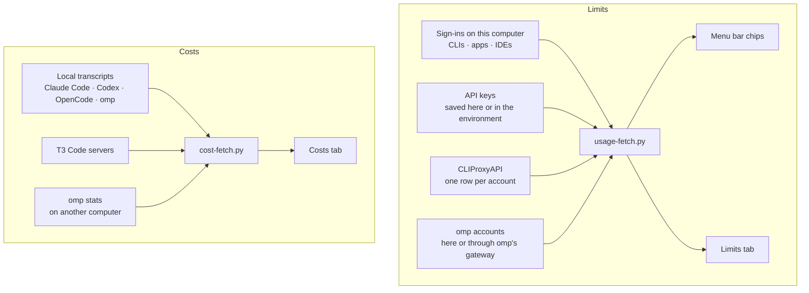

<div align="center">

# Quotatank

**Every AI coding limit, account, and dollar in the Omarchy menu bar: how much is left, which account is spending it, when it comes back, and how long it lasts at your pace.**

[](https://github.com/JanitorHead/omarchy-quotatank/releases) [](LICENSE)

[Install](#install) · [Providers](#providers) · [Accounts](#several-accounts-at-a-glance) · [Limits and pace](#limits-and-pace) · [Menu bar](#menu-bar) · [Costs](#costs) · [omp](#omp-oh-my-pi) · [Balances](#balances-not-just-percentages) · [Settings](#settings-that-apply-as-you-go)

</div>


Quotatank reads the plan limits and prepaid balances of **50 AI coding providers** with the sign-ins and keys you already have: several accounts per provider, every account behind a **CLIProxyAPI** server, and everything **omp (Oh My Pi)** is signed in to, on this computer or another. A second tab shows what your coding agents would cost at API rates, by day, model, project, and subagent.

<sub>Screenshots use fixture data in the Tokyo Night theme.</sub>

## Providers

**50 providers**, plus every account on a proxy or in omp. Each one is read with what it already uses on this computer; nothing to configure for a sign-in, one paste for a key. [Connect a source](#connect-a-source) says what each one shows and where its credentials come from.


`key` marks a sign-in that can also use an API key instead.

**Sign-ins on this computer.** Plan limits and allowances (5-hour, daily, weekly, monthly), read from the CLI, app, or IDE you are signed in to.

Claude Code · OpenAI Codex · Gemini CLI · Antigravity · GitHub Copilot · Cursor · Kimi Code · OpenCode Go `key` · Grok CLI · Kiro · JetBrains AI · Nous Portal (Hermes Agent) · Muse Code (Meta) · Droid (Factory) `key` · Amp `key` · Kilo Code `key` · Codebuff `key` · Hugging Face `key`

**Coding plans with an API key.** Subscription limits and credit packs.

Z.ai Coding Plan (and BigModel) · MiniMax Coding Plan · Synthetic · Chutes · Ollama Cloud · Warp · Cline (ClinePass) · ZenMux · Alibaba Coding Plan (Qwen) · Command Code · DevPass (LLM Gateway) · xKiro · IBM Bob · Umans · Neuralwatt · Aixy · ClawRouter

**Prepaid balances.** What you can still spend, in the provider's own currency, with low-balance alerts.

OpenRouter · DeepSeek · Moonshot · Venice · DeepInfra · Vercel AI Gateway · Poe · Atlas Cloud · Charm Hyper · Sail Research · Sofya · v0 · Manus · TypeSafe (Jev) · Xiaomi MiMo

**Several accounts.** Omarchy's Claude Code, Codex, and Grok accounts, extra API keys, CLIProxyAPI accounts, and omp's accounts, each read on its own.

## Why it is different

- **Several subscriptions, one glance.** A dot per account beside the chip says which one new sessions use and whether the others have room. When the one in use runs low, the chip says where to go next; Limits lists every account, and **Use** switches.
- **A run-out time, not just a percentage.** Each limit projects from your recent rate: `runs out 17:50` when it empties before the reset, `lasts until reset` when it does not. The meter shows where your pace takes it, and a runway card shows how long your accounts last together.
- **It shows spending as it happens.** With omp, each request marks its account as spending and adds to Costs the moment it lands. Without omp, a rise between readings does the same.
- **It finds what you already use, and fixes what is missing.** Sign-ins on this computer are picked up on their own. A signed-out provider gets a **Sign in** button; one whose CLI is missing gets **Install and sign in**, through Omarchy's mise.
- **Money where money is the limit.** Prepaid providers lead with what you can still spend, in their own currency, with low-balance alerts in amounts.
- **Motion that explains, nothing more.** Changed digits roll, a live request sends one ring from its account's dot, a crossed threshold or a reset flashes once. Routine refreshes only change numbers, and motion follows Hyprland's animation setting.
- **Settings that apply as you make them.** No Save button: flip a switch and watch the bar change.
- **Private by default.** Accounts appear as Account 1, Account 2, and so on unless you name them. Keys and tokens stay in private files, never in widget settings.

## Install

```bash
omarchy plugin add https://github.com/JanitorHead/omarchy-quotatank.git --enable
```

Then [connect a source](#connect-a-source). To update or remove:

```bash
omarchy plugin update janitorhead.quotatank
omarchy plugin remove janitorhead.quotatank
```

Installed before 18 October 2026 and `update` cannot fast-forward? See [Troubleshooting](https://github.com/JanitorHead/omarchy-quotatank/blob/main/docs/configuration.md#troubleshooting).

The built-in `omarchy.agents` widget can run alongside Quotatank. To keep only Quotatank, run `omarchy plugin disable omarchy.agents`. To put the chips somewhere else in the bar, use `omarchy bar move janitorhead.quotatank left`.

<details>
<summary>Requirements</summary>

- Omarchy with schema-v1 shell plugins.
- Python 3.10 or newer. The quota and cost backends use only the standard library.
- Network access for quota checks. Costs can download the public LiteLLM price table and contact the T3 or omp servers you configure.
- Optional: omp 18.9 or newer for omp's live account mapping.

</details>

## Several accounts at a glance


Every source of a second account shows the same way:

- **Claude Code, Codex, and Grok accounts added with Omarchy** (`omarchy agent account add claude work`). The account new sessions start with is marked **in use**; **Use** on another runs `omarchy agent account use` for you. The header shows Omarchy's rule: `switches at 95%` or `notifies at 95%`.
- **Several API keys for one provider.** Under **Settings → Providers**, a provider with a saved key offers **Add another key…**: name it and save it, and it is read on its own.
- **omp's accounts**, on this computer or through omp's gateway on another. An account you also use directly appears once.
- **CLIProxyAPI accounts**, each with its plan and its banked Codex and Claude resets behind a confirmation.

In the menu bar, a dot per account sits beside the chip: filled for the account counted, a ring coloured by each other account's state. Hover the chip for every account's 5-hour and weekly use and its trend. In Limits, each row says what matters now (`spending now`, `used up · back 18:02`, `switched 16:27`) next to a 24-hour trend you can read with the pointer; pick a row for its full detail.

**One at a time or together.** Omarchy accounts are used one at a time, so the chip follows the one in use. Accounts that omp or a proxy spend at once are counted together: the chip shows the one closest to its limit among those spending, rows sort by headroom and slide into place as that changes, and with omp a pool line says how much of the window is left across all of them. **Customize** fixes either mode per provider, and hides an account you do not want to see.

**Runway.** A card under the limits shows how long each account lasts until the 5-hour reset: one taking over from the other, or all running down side by side, and the gap with nothing left when they run out first.

## Limits and pace

Every limit card has a meter, a pace tick, and a forecast. The tick marks where even use would be by now, so blocks past it are use ahead of pace. A dashed stretch after the fill shows where the current pace takes the limit before it resets, red when it runs out first; faint marks show your warning and critical levels. Hover the meter for the time it reaches that level at this pace, or when it passed it. A 5-hour limit projects from its recent rate, newest samples weighing most; weekly and monthly limits blend this window's average with the last 24 hours, so one busy hour does not predict a weekly run-out. Hover a card's status line for how the tick and the projection work.

**Banked resets.** When Anthropic grants Claude a reset of its 5-hour and weekly limits (a launch reset, say), a card under the limits counts it and says when it expires. **Apply…** spends it after a confirmation; when Claude holds it back, the card says why.

<details>
<summary>Every status line</summary>

| Status line | Meaning |
|---|---|
| `runs out 17:50 · pace 58%` | At the projected rate, the limit empties before the window resets |
| `lasts until reset` | At the projected rate, the limit lasts until the window resets |
| `Idle 1h 2m · pace 40%` | A 5-hour limit has not risen for an hour, so no projection is made |
| `Collecting data · pace 12%` | A 5-hour limit has less than ten minutes of samples so far |
| `No recent data · pace 30%` | A 5-hour limit's newest sample is more than an hour old |
| `Pace starts after 2% of the window` | Less than 2% of the window has passed |
| `No usage yet` | Nothing has been used in this window |
| `used up` | The limit is 100% used |
| `No pace for this limit` | The provider reports no window length or reset time |

</details>


**Show limits as** flips every card, chip, and balance between used and left; **Providers → Customize** reads a single provider the other way. Warning and critical thresholds are stored as percent left, 25% and 10% by default.


When something is wrong, the panel says what and what to do: a used-up limit names when it comes back, a failed refresh names the command to run, and a drained balance says it needs topping up. A signed-out provider has a **Sign in** button; the panel refreshes on its own until the sign-in lands. An old reading fades and says how old it is.

## Menu bar


- **Limit shown** picks the window every chip shows. The default is each provider's most constrained limit; 5-hour, 7-day, and monthly pin one window. Every line is tagged with its period (`7d 91%`).
- **Second limit below** stacks a second limit under the first; **Show when limits reset** appends when each line resets.
- **Accounts** keeps one chip per provider with a dot per account, or gives each account its own chip.
- **Hide providers that are used up** takes a provider out of the bar until its weekly or monthly limit resets; with several accounts, only the used-up accounts leave until all of them are.
- **Chips in the bar** caps how many chips the bar holds, four by default, and folds the rest into a `+N` chip.
- **Provider colors** paints each chip and meter in the provider's brand color; alerts always use the theme's alert color.

Clicking a chip opens that provider. A desktop notification fires when a limit or a balance crosses your warning or critical threshold, and again after it recovers or resets.

## Costs


Costs estimates what your recorded tokens would cost at API rates. It is not a bill, a subscription charge, or a credit balance.

- **The total** compares with the previous period of the same length.
- **The chart** keeps each day in place when you switch between 24 hours, 7 days, and 30 days; the pointer reads any bar. Hover a provider to highlight it, click it to isolate it and rescale the chart.
- **Breakdown** by model, by project, or main sessions against subagents.
- **When** maps the last seven days by hour, so you see when you spend.
- **Live with omp**: each request adds to the total and to today's bar as it lands.

Local Claude Code, Codex, OpenCode, and omp history are read on this computer; T3 Code servers and an omp stats dashboard bring in other computers. Prices come from the public LiteLLM table, and **Custom prices** set your own per exact model ID.

## omp (Oh My Pi)


If you work through [omp](https://github.com/can1357/oh-my-pi), Quotatank reads what omp knows:

- **On this computer**, it merges omp's accounts into the providers you already monitor and follows omp's sessions: requests mark their account as spending, and Costs gains projects and subagents.
- **On another computer**, run `omp stats` there and enter its address under **Settings → Costs → omp on another computer** for costs and live activity; optionally, point **Settings → Providers → omp** at omp's auth gateway for limits. Settings gives the commands for Tailscale or an SSH tunnel and tests the connection.

The omp stats dashboard has no password and also serves conversations, so keep it on Tailscale or behind SSH. Quotatank only asks it for statistics, and asks the gateway only for usage.

## Balances, not just percentages


Prepaid providers show money: what the account can still spend, which for OpenRouter is the lowest of the balance and every spending limit's allowance. The headline adds how long it lasts at this week's rate, limits that reset become ordinary limit cards with a pace, a CNY-only DeepSeek or Moonshot account shows yuan, and Poe counts points. **Low balance** alerts are amounts in the balance's currency, `5` and `1` by default.

## Follows your theme


Colors and control borders come from the active Omarchy theme and change with it; text uses your Omarchy font, and every provider mark is the real brand mark at one size.

## Settings that apply as you go


The gear opens an index of six pages, and each row already says what the page is set to. There is no Save button: every switch, selector, and valid number applies the moment it changes, so you can compare the bar with the setting still in front of you. Keys and tokens are the exception, with an explicit **Save** that writes a private file, after which the page shows **Replace** and **Remove**.

| Page | What lives there |
|---|---|
| **Providers** | The source (local sign-ins or a CLIProxyAPI server). **Found on this computer** offers sign-ins Quotatank detected but is not monitoring, with **Monitor** and **Ignore**. **Monitored** gives each provider in use its own card with its mark: what the last check found (`Connected · Claude Max 20x`, `Sign-in expired`, `No key saved`) and, when signed out, a **Sign in** or **Install and sign in** button; a grip to drag it into the order tiles and chips follow; **Monitor** and **Menu bar** switches; its key editor when it takes an API key; and **Customize** to read it as used or left and pin the limits its chip shows. **More providers** folds away everything else, filterable by name, with the same buttons, a link to get each tool, and a link to each provider's key page. Last, **omp**: read its accounts here, or through its gateway on another computer |
| **Menu bar** | Chips or the widget icon, the limit each chip shows, a second limit, reset times and formats, one chip per provider or per account, how many chips the bar holds, hiding used-up providers |
| **Alerts** | Desktop notifications, the percentage thresholds, and the low-balance amounts |
| **Display** | Used or left, provider colors, square cards, hidden account emails, motion |
| **Costs** | Local history, T3 servers, omp on another computer, custom prices, and the last scan |
| **Advanced** | Refresh interval (1 to 60 minutes), diagnostics, **Back up and restore** (every setting and saved key in one passphrase-encrypted file), and **Reset to defaults**, which keeps your source, keys, T3 servers, and custom prices |

Every key is listed in the [settings reference](https://github.com/JanitorHead/omarchy-quotatank/blob/main/docs/configuration.md#settings).

Privacy:

- Quotatank reads existing CLI, app, and IDE sign-ins and never writes, rotates, or deletes authentication state. Quota checks are read-only and never spend quota.
- Gemini CLI access tokens last an hour. When the saved one has expired, Quotatank exchanges Gemini CLI's refresh token for a new access token that lives only in memory for that check, using the sign-in client of the Gemini CLI installed on this computer; nothing is written back.
- **Sign in** and **Install and sign in** only run when you press them, in a terminal you can see, with the provider's own sign-in command.
- Antigravity is read from its own running language server on `127.0.0.1`, using the session token that process was started with, or from `agy`'s usage report. GitHub Copilot can fall back to `gh auth token`. Both commands run without a shell, with a timeout and no browser.
- Claude Code access tokens last about eight hours. When the saved one has expired, Quotatank runs `claude doctor`, which renews and saves Claude Code's own sign-in without a prompt or a model request, so a computer where you rarely open Claude Code stays signed in. Quotatank never uses Claude's refresh token itself.
- Applying a banked reset is a separate action that asks for confirmation first: Codex resets in CLIProxyAPI mode, Claude resets with a Claude Code sign-in or through CLIProxyAPI. Claude lists these resets only to Claude Code, so Claude's usage requests identify as Claude Code (`claude-cli`), as omp does.
- omp runs only where it is already set up, with fixed arguments, a timeout, and no secrets; it never outlives Quotatank's helper. Its sessions are read for numbers only: provider, model, tokens, cost, and time, never prompts or output.
- The omp gateway token, the CLIProxyAPI management key, the Keeper password, and T3 tokens go over HTTPS, or over plain HTTP only through Tailscale or to this computer, and there only to a server that runs as you (or root): a port another account on the computer holds gets nothing. Antigravity's session token gets the same check on `127.0.0.1`.
- **Use** runs `omarchy agent account use`, which changes which login new sessions start with; no credential is touched.
- API keys, management keys, and T3 tokens are saved in private files (`0600`, in a `0700` directory), never in widget settings or command-line arguments. **Remove** deletes the file. A backup holds them encrypted with your passphrase (gpg, AES-256); without the passphrase they cannot be recovered.
- Cost history stores token counts, timestamps, model names, and hashed transcript identifiers. It never stores prompts, responses, or tool output.
- HTTPS certificates are verified, and redirects are rejected. The one exception is Antigravity's loopback language server, whose self-signed certificate is accepted on `127.0.0.1` only.

## Connect a source

Limits and Costs have separate sources. A proxy can supply Limits while local transcripts supply Costs.



### Sign-ins on this computer

Sign in to each tool the way you already do, or from Quotatank: **Sign in** opens the command below in a floating terminal, and **Install and sign in** first installs the CLI with `mise use -g` (the way `omarchy default agent` installs agents) when it is not on PATH. Tools that are not CLIs, such as an IDE, get a link to their download page instead. Quotatank picks up the sign-ins it finds: new installations monitor every provider below by default and show the ones that are signed in; if you set Quotatank up before, **Settings → Providers → Found on this computer** offers the new ones with one click.

| Provider | Sign in with | Shows |
|---|---|---|
| Claude Code | `claude auth login` | 5-hour and weekly limits, model limits, extra usage |
| OpenAI Codex | `codex login` | 5-hour and weekly limits, credits |
| Gemini CLI | `gemini`, signed in with Google | Daily request limits per model |
| Antigravity | The Antigravity app or IDE while it runs, or `agy` | 5-hour and weekly limits per model group |
| GitHub Copilot | `gh auth login`, or the Copilot sign-in of your editor | Monthly chat, completions, and premium request allowances |
| Cursor | The Cursor app, or `cursor-agent login` | The monthly plan allowance and on-demand spend |
| Kimi Code | `kimi login` | Weekly and 5-hour limits |
| OpenCode Go | `opencode auth login` with OpenCode Console or a Go key, or `OPENCODE_GO_API_KEY` | 5-hour, weekly, and monthly limits |
| Grok CLI | `grok login` | The billing-period allowance |
| Kiro | `kiro-cli login` | Monthly credits and overage |
| JetBrains AI | AI Assistant in any JetBrains IDE | The monthly quota and top-up credits, read from the IDE's own files |
| Nous Portal | `hermes portal` (Hermes Agent) | Monthly credits and the top-up balance |
| Muse Code | `muse login` | 5-hour and weekly subscription limits |
| Droid (Factory) | `droid`, or a saved `FACTORY_API_KEY` | Weekly and monthly token allowances |
| Amp | `amp login`, or a saved key | Free daily credits and monthly plan usage |
| Kilo Code | `kilo auth login`, or a saved key | The Kilo Pass allowance and credit balance |
| Codebuff | `codebuff login`, or a saved key | Weekly limit and credits |
| Hugging Face | `hf auth login`, or a saved token | The inference spending limit |

### API keys

Turn the provider on under **Settings → Providers → More providers**, then save its key; **Get a key ↗** opens the page that issues one. A key in the provider's environment variable works too and takes precedence.

| Provider | Key | Shows |
|---|---|---|
| Z.ai Coding Plan | API key, or `Z_AI_API_KEY` (BigModel keys work too) | 5-hour and weekly prompt limits, monthly MCP tool calls |
| MiniMax Coding Plan | Subscription Key (`sk-cp-…`), or `MINIMAX_CODING_API_KEY` | 5-hour and weekly limits, credit packs |
| Synthetic | API key, or `SYNTHETIC_API_KEY` | 5-hour and weekly limits |
| Chutes | API key, or `CHUTES_API_KEY` | 4-hour and monthly subscription limits |
| Ollama Cloud | API key, or `OLLAMA_API_KEY` | The monthly included allowance and purchased credits |
| Warp | Personal API key, or `WARP_API_KEY` | Monthly AI credits and add-on credits |
| Cline | API key, or `CLINE_API_KEY` | ClinePass 5-hour, weekly, and monthly limits |
| ZenMux | Management key, or `ZENMUX_MANAGEMENT_API_KEY` | 5-hour and 7-day flow limits, pay-as-you-go credits |
| Alibaba Coding Plan | API key, or `ALIBABA_CODING_PLAN_API_KEY` | 5-hour, weekly, and monthly Coding Plan quotas |
| Command Code | API key, or `COMMAND_CODE_API_KEY` | Monthly plan credits, the 5-hour and weekly limits, and purchased credits; a team key shows its organisation's pool |
| DevPass | API key, or `DEVPASS_API_KEY` | Plan credits for the cycle and the premium weekly limit |
| xKiro | API key, or `XKIRO_API_KEY` | Plan windows, the daily free-token allowance, and the wallet balance |
| IBM Bob | API key, or `BOBSHELL_API_KEY` | Monthly Bobcoin usage against the team budget |
| Umans | API key, or `UMANS_AI_CODING_PLAN_API_KEY` | The 5-hour request limit (model-weighted) |
| Neuralwatt | API key, or `NEURALWATT_API_KEY` | The billing period's kWh allowance, the key's allowance, and the prepaid balance |
| Aixy | API key, or `AIXY_API_KEY` | Each budget that applies to the key |
| ClawRouter | API key, or `CLAWROUTER_API_KEY` | The monthly spend budget and the month's cost |
| OpenRouter | API key, or `OPENROUTER_API_KEY` | The key's limits, the balance, and spend |
| DeepSeek | API key, or `DEEPSEEK_API_KEY` | The platform balance per currency |
| Moonshot | API key, or `MOONSHOT_API_KEY` | The balance, international or China |
| Venice | Admin API key, or `VENICE_API_KEY` | Daily DIEM allocation and USD balance |
| DeepInfra | API key, or `DEEPINFRA_API_KEY` | The balance, spending limit, and this month's spend |
| Vercel AI Gateway | API key, or `AI_GATEWAY_API_KEY` | Gateway credits and lifetime spend |
| Poe | API key, or `POE_API_KEY` | The points balance |
| Atlas Cloud | API key with balance access, or `ATLASCLOUD_API_KEY` | The USD balance |
| Charm Hyper | API key, or `HYPER_API_KEY` | The Hypercredit balance |
| Sail Research | API key, or `SAIL_API_KEY` | The credit balance and recent spend |
| Sofya | API key, or `SOFYA_API_KEY` | Available credits, and the free-tier reset |
| v0 | API key, or `V0_API_KEY` | The billing allowance, or the prepaid balance |
| Manus | API key, or `MANUS_API_KEY` | The credit balance and the next refresh |
| TypeSafe | The console's Cookie header, or `TYPESAFE_COOKIE`: TypeSafe has no balance API for keys | The prepaid balance, this cycle's spend, and credit expiry |
| Xiaomi MiMo | The console's Cookie header, or `MIMO_COOKIE`: MiMo has no balance API for keys | The prepaid balance with its paid and granted parts, and a Token Plan's monthly credits until the period ends |

Quotatank reads existing credentials and never writes authentication state; sign-in stays with each tool. Claude Code, OpenAI Codex, OpenCode Go, OpenRouter, GitHub Copilot, and Xiaomi MiMo have been checked against live accounts. The other providers follow their documentation and established open-source readers (CodexBar, oh-my-pi) and are tested against recorded responses. Providers without public documentation (Alibaba Coding Plan, IBM Bob, ClawRouter, TypeSafe, Xiaomi MiMo) can break when the provider changes its site. The [configuration reference](https://github.com/JanitorHead/omarchy-quotatank/blob/main/docs/configuration.md#providers-and-authentication) lists the files and endpoints each provider uses.

### CLIProxyAPI

1. Open **Settings → Providers** and choose **CLIProxyAPI** under **Source**.
2. Enter the server URL, for example `http://127.0.0.1:8317`, and leave the field.
3. Enter the Management API key that the server's management panel accepts and press **Save**. Client API keys and bcrypt hashes do not work.
4. Managed accounts are discovered automatically, one row each.

The key is saved to a private file (`0600`) and is never loaded back into the form. Remote servers must allow remote management. Quota lookups cover Claude, Codex, Kimi, and Antigravity accounts; other providers show an unsupported notice.

The optional CPA Usage Keeper adds the last-used account to the menu bar. See the [account activity guide](https://github.com/JanitorHead/omarchy-quotatank/blob/main/docs/keeper-deployment.md).

### omp

On this computer nothing needs setting up: with omp signed in, **Settings → Providers → omp** shows what it found and **Read omp's accounts** is on. For another computer:

1. There, run `omp stats --host "$(tailscale ip -4)" --port 3847` (or `omp stats --port 3847` and, here, `ssh -N -L 3847:127.0.0.1:3847 <host>`).
2. Here, open **Settings → Costs → omp on another computer**, enter the address, and press **Test**.
3. For limits too, run `omp auth-gateway serve` there, then enter its address and the token from `omp auth-gateway token` under **Settings → Providers → omp → On another computer**.

The [configuration reference](https://github.com/JanitorHead/omarchy-quotatank/blob/main/docs/configuration.md#omp-oh-my-pi) has the details, including keeping both services running after a reboot.

### Cost history

Open **Settings → Costs**. Local Codex CLI, Claude Code, OpenCode, and omp history are on by default; **omp on another computer** reads an omp stats dashboard. Add up to four T3 Code servers, each with a name, base URL, and connection token. Servers must use usage contract version 4 or 5. Custom model prices are set on the same page, by exact model ID.

## Controls

| Action | Control |
|---|---|
| Open or close the panel | Left click on the bar |
| Next provider | Middle click on the bar, or `p` on Limits |
| Switch tabs | `u` for Limits, `c` for Costs |
| Refresh | `r` |
| Costs metric, token details, model breakdown | `m`, `d`, `b` |
| Settings | `s` |
| Back to the settings index, then close | Escape |

Scripts and keybindings can use the shell IPC:

```bash
omarchy-shell janitorhead.quotatank limits
omarchy-shell janitorhead.quotatank costs
omarchy-shell janitorhead.quotatank refresh
```

The other commands are `open`, `close`, `toggle`, `show`, `hide`, `next`, `configure`, `configureProviders`, `configureCosts`, and `exportJson`. While hide-emails is on, `exportJson` writes numbered account labels instead of identities.

## Documentation

- [Configuration and troubleshooting](https://github.com/JanitorHead/omarchy-quotatank/blob/main/docs/configuration.md)
- [Quota contract](https://github.com/JanitorHead/omarchy-quotatank/blob/main/docs/backend-contract.md) and [cost contract](https://github.com/JanitorHead/omarchy-quotatank/blob/main/docs/cost-contract.md)
- [Development](https://github.com/JanitorHead/omarchy-quotatank/blob/main/docs/development.md), [changelog](https://github.com/JanitorHead/omarchy-quotatank/blob/main/CHANGELOG.md), and [security policy](https://github.com/JanitorHead/omarchy-quotatank/blob/main/SECURITY.md)

## Credits and license

Quotatank started as a fork of [omarchy-modelusage](https://github.com/DigitalPals/omarchy-modelusage) by DigitalPals, released under the MIT license, and is MIT licensed too. See [LICENSE](LICENSE) and [THIRD_PARTY_NOTICES.md](THIRD_PARTY_NOTICES.md). Provider names and marks belong to their owners and do not imply endorsement.
