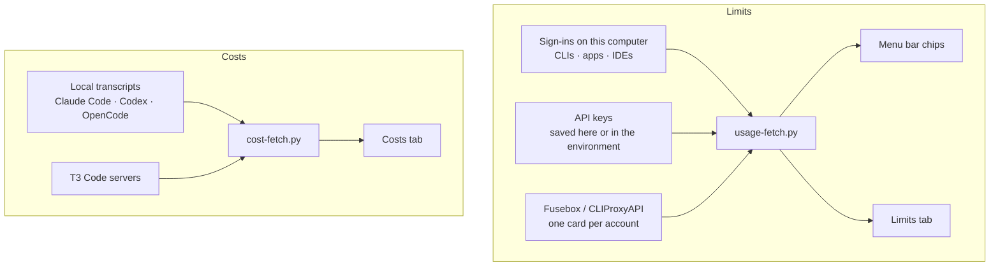

<div align="center">

# Quotatank

**Every AI coding limit you pay for, in the Omarchy menu bar: how much is left, when it comes back, and how long it lasts at your pace.**

[](https://github.com/JanitorHead/omarchy-quotatank/releases) [](LICENSE)

[Install](#install) · [Providers](#providers) · [Limits and pace](#limits-and-pace) · [Balances](#balances-not-just-percentages) · [Menu bar](#menu-bar) · [Accounts](#one-card-per-account) · [Costs](#costs) · [Settings](#settings-that-apply-as-you-go)

</div>


Quotatank reads the plan limits and prepaid balances of **49 AI coding providers**, with the sign-ins and keys you already have, or every account behind a **Fusebox or CLIProxyAPI** server. A second tab estimates what your recorded tokens would cost at API rates.

<sub>Screenshots use fixture data in the Tokyo Night theme.</sub>

## Providers

**49 providers**, plus every account on a proxy. Each one is read with what it already uses on this computer; nothing to configure for a sign-in, one paste for a key. [Connect a source](#connect-a-source) says what each one shows and where its credentials come from.


`key` marks a sign-in that can also use an API key instead.

**Sign-ins on this computer.** Plan limits and allowances (5-hour, daily, weekly, monthly), read from the CLI, app, or IDE you are signed in to.

Claude Code · OpenAI Codex · Gemini CLI · Antigravity · GitHub Copilot · Cursor · Kimi Code · OpenCode Go `key` · Grok CLI · Kiro · JetBrains AI · Nous Portal (Hermes Agent) · Muse Code (Meta) · Droid (Factory) `key` · Amp `key` · Kilo Code `key` · Codebuff `key` · Hugging Face `key`

**Coding plans with an API key.** Subscription limits and credit packs.

Z.ai Coding Plan (and BigModel) · MiniMax Coding Plan · Synthetic · Chutes · Ollama Cloud · Warp · Cline (ClinePass) · ZenMux · Alibaba Coding Plan (Qwen) · Command Code · DevPass (LLM Gateway) · xKiro · IBM Bob · Umans · Neuralwatt · Aixy · ClawRouter

**Prepaid balances.** What you can still spend, in the provider's own currency, with low-balance alerts.

OpenRouter · DeepSeek · Moonshot · Venice · DeepInfra · Vercel AI Gateway · Poe · Atlas Cloud · Charm Hyper · Sail Research · Sofya · v0 · Manus · TypeSafe (Jev)

**Proxies.** Every Claude, Codex, Kimi, and Antigravity account on the server gets its own card, with live activity on Fusebox.

Fusebox · CLIProxyAPI

## Why it is different

- **It finds what you already use, and fixes what is missing.** Sign-ins on this computer are picked up on their own, and one quiet line in Limits names any it found that you are not monitoring yet. A provider that is signed out gets a **Sign in** button that opens its sign-in in a terminal; one whose CLI is missing gets **Install and sign in**, through Omarchy's mise. Providers you do not have never show up.
- **A run-out time, not just a percentage.** Each limit card projects from your recent rate: `Runs out in 1h 9m` when the limit would empty before it resets, `Lasts until reset` when it would not. One headline above the cards gives the answer for the whole provider.
- **A pace tick on the meter.** A tick marks where even use would have put you by now; blocks past it are use ahead of pace, and a badge counts the points ahead or behind.
- **Money where money is the limit.** Prepaid providers such as OpenRouter, DeepSeek, Moonshot, and Venice lead with what you can still spend, in their own currency, with low-balance alerts in amounts rather than percentages.
- **Two limits and their reset times in each chip.** Stack a second limit under the first, show when each one resets, or hide a provider from the bar while its weekly limit is used up.
- **Settings that apply as you make them.** No Save button: flip a switch and watch the bar change, then flip it back.
- **Alerts that re-arm.** A desktop notification fires when a limit or a balance crosses your warning or critical threshold, and again after it recovers or resets.
- **Private by default.** Accounts appear as Account 1, Account 2, and so on. Keys and tokens stay in private files, never in widget settings.

## Install

```bash
omarchy plugin add https://github.com/JanitorHead/omarchy-quotatank.git --enable
```

Then [connect a source](#connect-a-source). To update or remove:

```bash
omarchy plugin update janitorhead.quotatank
omarchy plugin remove janitorhead.quotatank
```

The built-in `omarchy.agents` widget can run alongside Quotatank. To keep only Quotatank, run `omarchy plugin disable omarchy.agents`. To put the chips somewhere else in the bar, use `omarchy bar move janitorhead.quotatank left`.

<details>
<summary>Requirements</summary>

- Omarchy with schema-v1 shell plugins.
- Python 3.10 or newer. The quota and cost backends use only the standard library.
- Network access for quota checks. Costs can download the public LiteLLM price table and contact the T3 servers you configure.
- Optional: Python `websockets` 15 or newer, for live account activity from Fusebox.

</details>

## Limits and pace


The tick marks where even use would be by now, so blocks past it are use ahead of pace. The status line projects when the limit would run out: a 5-hour limit from its recent rate, newest samples weighing most; weekly and monthly limits from this window's average blended with the last 24 hours, so one busy hour does not predict a weekly run-out and a quiet weekend does not hide a heavy week. Here the limit runs out in 1h 9m, before its window resets in 2h 4m. Cards are ordered shortest window first, and every provider names its windows the same way: `5-hour limit`, `Weekly limit`, `Monthly limit`.

<details>
<summary>Every status line</summary>

| Status line | Meaning |
|---|---|
| `Runs out in 1h 9m · pace 58%` | At the projected rate, the limit empties before the window resets |
| `Lasts until reset · pace 55%` | At the projected rate, the limit lasts until the window resets |
| `Idle 1h 2m · pace 40%` | A 5-hour limit has not risen for an hour, so no projection is made |
| `Collecting data · pace 12%` | A 5-hour limit has less than ten minutes of samples so far |
| `No recent data · pace 30%` | A 5-hour limit's newest sample is more than an hour old |
| `Pace starts after 2% of the window` | Less than 2% of the window has passed |
| `No usage yet` | Nothing has been used in this window |
| `Limit reached` | The limit is 100% used |
| `No pace for this limit` | The provider reports no window length or reset time |

</details>


**Show limits as** flips every card, chip, and balance between used and left; **Providers → Customize** reads a single provider the other way. The meter, the tick, and the pace share follow the setting. Warning and critical thresholds are stored as percent left, 25% and 10% by default, so the Opus limit is critical at 9% left whichever way you read it.


When something is wrong, the panel says what and what to do: a used-up limit names when it comes back, a failed refresh names the command to run, and a drained balance says it needs topping up. A signed-out provider's card has a **Sign in** button; the panel refreshes on its own until the sign-in lands. The chip in the bar shows a short reason instead of a figure (`sign in`, `rate limited`, `offline`), and hovering it gives the full message.

## Balances, not just percentages


Prepaid providers — OpenRouter, DeepSeek, Moonshot, Venice, DeepInfra, Vercel AI Gateway, and Poe — show money: what the account can still spend, which for OpenRouter is the lowest of the balance and every spending limit's allowance. The headline adds how long it lasts at this week's rate (`$74.00 left · lasts about 8 weeks`), limits that reset become ordinary limit cards with a pace, a CNY-only DeepSeek or Moonshot account shows yuan, and Poe counts points. **Low balance** alerts are amounts in the balance's currency, `5` and `1` by default. Credit packs that sit beside a plan, such as MiniMax's or Warp's add-on credits, are shown but never raise a low-balance alert.

## Menu bar


- **Limit shown** picks the window every chip shows. The default is each provider's most constrained limit; 5-hour, 7-day, and monthly pin one window. Every line is tagged with the period of the limit it shows (`7d 91%`), so the tag never lies about what is behind the number.
- **Second limit below** stacks a second limit under the first.
- **Show when limits reset** appends when each line resets: a time for limits that reset within a day, a date for weekly and monthly ones, in the formats you choose.
- **Hide providers that are used up** takes a provider out of the bar while one of its weekly or monthly limits is used up; it returns when the limit resets, and Limits keeps showing it.
- **Chips in the bar** caps how many chips the bar holds, four by default. Past that it keeps the providers closest to a limit, in their usual order, and folds the rest into a `+N` chip that names them.
- **Provider colors** paints each chip and limit meter in the provider's brand color.

Money providers lead with their balance and stack their tightest limit below. Clicking a chip opens that provider.

A chip switches to the Omarchy theme's alert color when either of its lines is at warning or critical, and keeps it with provider colors on, so a brand color never hides an alert. Quotatank has no red of its own: the color comes from the theme.

## One card per account


Several subscriptions of one provider show the same way, each on its own card with the name you gave it:

- **Claude Code, Codex, and Grok accounts added with Omarchy** (`omarchy agent account add claude work`) are picked up on their own. The card of the account new sessions start as is marked **in use**, and the chip in the bar follows it.
- **Several API keys for one provider**: under **Settings → Providers**, a provider with a saved key offers **Add another key…**. Name it (Work, Personal, a client) and save it; each key is read on its own and gets its own card. The environment variable only ever replaces the first key.

With Fusebox or CLIProxyAPI as the source, every managed account gets its own card with its own plan, percentage, and reset time. Each card shows the account's weekly limit when it reports one; **Additional limits** opens the others.

In CLIProxyAPI mode, Codex cards show how many banked resets the account holds. A banked reset resets that account's current Codex usage limits and is spent once applied, so clicking a nonzero badge opens a confirmation first. It lists each reset with its expiry, selects the one expiring soonest, and applies nothing until you choose **Apply reset**.

## Follows your theme


Colors and control borders come from the active Omarchy theme and change with it; text uses your Omarchy font, and every provider mark is the real brand mark at one size. Cards are square by default; turn off **Square cards** to follow the theme's corners.

## Costs


Costs estimates what your recorded tokens would cost at API rates. It is not a bill, a subscription charge, or a credit balance. Pick 24 hours, 7 days, or 30 days, then open token details or the model breakdown, which lists every model with its provider, tokens, and estimate.

Local Claude Code, Codex, and OpenCode history are on by default, and up to four T3 Code servers bring in history from other computers. Prices come from the public LiteLLM table. Under **Custom prices**, set input, output, and optional cache prices in USD per million tokens for an exact model ID.

## Settings that apply as you go


The gear opens an index of six pages, and each row already says what the page is set to. There is no Save button: every switch, selector, and valid number applies the moment it changes, so you can compare the bar with the setting still in front of you. Keys and tokens are the exception, with an explicit **Save** that writes a private file, after which the page shows **Replace** and **Remove**.

| Page | What lives there |
|---|---|
| **Providers** | The source (local sign-ins or a Fusebox / CLIProxyAPI server). **Found on this computer** offers sign-ins Quotatank detected but is not monitoring, with **Monitor** and **Ignore**. **Monitored** gives each provider in use its own card with its mark: what the last check found (`Connected · Claude Max 20x`, `Sign-in expired`, `No key saved`) and, when signed out, a **Sign in** or **Install and sign in** button; a grip to drag it into the order tiles and chips follow; **Monitor** and **Menu bar** switches; its key editor when it takes an API key; and **Customize** to read it as used or left and pin the limits its chip shows. **More providers** folds away everything else, filterable by name, with the same buttons, a link to get each tool, and a link to each provider's key page |
| **Menu bar** | Chips or the widget icon, the limit each chip shows, a second limit, reset times and formats, how many chips the bar holds, hiding used-up providers |
| **Alerts** | Desktop notifications, the percentage thresholds, and the low-balance amounts |
| **Display** | Used or left, provider colors, square cards, hidden account emails |
| **Costs** | Local history, T3 servers, custom prices, and the last scan |
| **Advanced** | Refresh interval (1 to 60 minutes), diagnostics, **Back up and restore** (every setting and saved key in one passphrase-encrypted file), and **Reset to defaults**, which keeps your source, keys, T3 servers, and custom prices |

Every key is listed in the [settings reference](https://github.com/JanitorHead/omarchy-quotatank/blob/main/docs/configuration.md#settings).

Privacy:

- Quotatank reads existing CLI, app, and IDE sign-ins and never writes, rotates, or deletes authentication state. Quota checks are read-only and never spend quota.
- Gemini CLI access tokens last an hour. When the saved one has expired, Quotatank exchanges Gemini CLI's refresh token for a new access token that lives only in memory for that check, using the sign-in client of the Gemini CLI installed on this computer; nothing is written back.
- **Sign in** and **Install and sign in** only run when you press them, in a terminal you can see, with the provider's own sign-in command.
- Antigravity is read from its own running language server on `127.0.0.1`, using the session token that process was started with, or from `agy`'s usage report. GitHub Copilot can fall back to `gh auth token`. Both commands run without a shell, with a timeout and no browser.
- Claude Code access tokens last about eight hours. When the saved one has expired, Quotatank runs `claude doctor`, which renews and saves Claude Code's own sign-in without a prompt or a model request, so a computer where you rarely open Claude Code stays signed in. Quotatank never uses Claude's refresh token itself.
- Applying a banked Codex reset is a separate action in CLIProxyAPI mode, and it asks for confirmation first.
- API keys, management keys, and T3 tokens are saved in private files (`0600`, in a `0700` directory), never in widget settings or command-line arguments. **Remove** deletes the file. A backup holds them encrypted with your passphrase (gpg, AES-256); without the passphrase they cannot be recovered.
- Cost history stores token counts, timestamps, model names, and hashed transcript identifiers. It never stores prompts, responses, or tool output.
- HTTPS certificates are verified, and redirects are rejected. The one exception is Antigravity's loopback language server, whose self-signed certificate is accepted on `127.0.0.1` only.

## Connect a source

Limits and Costs have separate sources. A proxy can supply Limits while local transcripts supply Costs.



### Sign-ins on this computer

Sign in to each tool the way you already do, or from Quotatank: **Sign in** opens the command below in a floating terminal, and **Install and sign in** first installs the CLI with `mise use -g` (the way `omarchy default agent` installs agents) when it is not on PATH. Tools that are not CLIs, such as an IDE, get a link to their download page instead. Quotatank picks up the sign-ins it finds: new installations monitor every provider below by default and show the ones that are signed in; if you set Quotatank up before, **Settings → Providers → Found on this computer** offers the new ones with one click.

| Provider | Sign in with | Shows |
|---|---|---|
| Claude Code | `claude auth login` | 5-hour and weekly limits, model limits, extra usage |
| OpenAI Codex | `codex login` | 5-hour and weekly limits, credits |
| Gemini CLI | `gemini`, signed in with Google | Daily request limits per model |
| Antigravity | The Antigravity app or IDE while it runs, or `agy` | 5-hour and weekly limits per model group |
| GitHub Copilot | `gh auth login`, or the Copilot sign-in of your editor | Monthly chat, completions, and premium request allowances |
| Cursor | The Cursor app, or `cursor-agent login` | The monthly plan allowance and on-demand spend |
| Kimi Code | `kimi login` | Weekly and 5-hour limits |
| OpenCode Go | `opencode auth login`, or `OPENCODE_GO_API_KEY` | 5-hour, weekly, and monthly limits |
| Grok CLI | `grok login` | The billing-period allowance |
| Kiro | `kiro-cli login` | Monthly credits and overage |
| JetBrains AI | AI Assistant in any JetBrains IDE | The monthly quota and top-up credits, read from the IDE's own files |
| Nous Portal | `hermes portal` (Hermes Agent) | Monthly credits and the top-up balance |
| Muse Code | `muse login` | 5-hour and weekly subscription limits |
| Droid (Factory) | `droid`, or a saved `FACTORY_API_KEY` | Weekly and monthly token allowances |
| Amp | `amp login`, or a saved key | Free daily credits and monthly plan usage |
| Kilo Code | `kilo auth login`, or a saved key | The Kilo Pass allowance and credit balance |
| Codebuff | `codebuff login`, or a saved key | Weekly limit and credits |
| Hugging Face | `hf auth login`, or a saved token | The inference spending limit |

### API keys

Turn the provider on under **Settings → Providers → More providers**, then save its key; **Get a key ↗** opens the page that issues one. A key in the provider's environment variable works too and takes precedence.

| Provider | Key | Shows |
|---|---|---|
| Z.ai Coding Plan | API key, or `Z_AI_API_KEY` (BigModel keys work too) | 5-hour and weekly prompt limits, monthly MCP tool calls |
| MiniMax Coding Plan | Subscription Key (`sk-cp-…`), or `MINIMAX_CODING_API_KEY` | 5-hour and weekly limits, credit packs |
| Synthetic | API key, or `SYNTHETIC_API_KEY` | 5-hour and weekly limits |
| Chutes | API key, or `CHUTES_API_KEY` | 4-hour and monthly subscription limits |
| Ollama Cloud | API key, or `OLLAMA_API_KEY` | The monthly included allowance and purchased credits |
| Warp | Personal API key, or `WARP_API_KEY` | Monthly AI credits and add-on credits |
| Cline | API key, or `CLINE_API_KEY` | ClinePass 5-hour, weekly, and monthly limits |
| ZenMux | Management key, or `ZENMUX_MANAGEMENT_API_KEY` | 5-hour and 7-day flow limits, pay-as-you-go credits |
| Alibaba Coding Plan | API key, or `ALIBABA_CODING_PLAN_API_KEY` | 5-hour, weekly, and monthly Coding Plan quotas |
| Command Code | API key, or `COMMAND_CODE_API_KEY` | Monthly plan credits, the 5-hour and weekly limits, and purchased credits; a team key shows its organisation's pool |
| DevPass | API key, or `DEVPASS_API_KEY` | Plan credits for the cycle and the premium weekly limit |
| xKiro | API key, or `XKIRO_API_KEY` | Plan windows, the daily free-token allowance, and the wallet balance |
| IBM Bob | API key, or `BOBSHELL_API_KEY` | Monthly Bobcoin usage against the team budget |
| Umans | API key, or `UMANS_AI_CODING_PLAN_API_KEY` | The 5-hour request limit (model-weighted) |
| Neuralwatt | API key, or `NEURALWATT_API_KEY` | The billing period's kWh allowance, the key's allowance, and the prepaid balance |
| Aixy | API key, or `AIXY_API_KEY` | Each budget that applies to the key |
| ClawRouter | API key, or `CLAWROUTER_API_KEY` | The monthly spend budget and the month's cost |
| OpenRouter | API key, or `OPENROUTER_API_KEY` | The key's limits, the balance, and spend |
| DeepSeek | API key, or `DEEPSEEK_API_KEY` | The platform balance per currency |
| Moonshot | API key, or `MOONSHOT_API_KEY` | The balance, international or China |
| Venice | Admin API key, or `VENICE_API_KEY` | Daily DIEM allocation and USD balance |
| DeepInfra | API key, or `DEEPINFRA_API_KEY` | The balance, spending limit, and this month's spend |
| Vercel AI Gateway | API key, or `AI_GATEWAY_API_KEY` | Gateway credits and lifetime spend |
| Poe | API key, or `POE_API_KEY` | The points balance |
| Atlas Cloud | API key with balance access, or `ATLASCLOUD_API_KEY` | The USD balance |
| Charm Hyper | API key, or `HYPER_API_KEY` | The Hypercredit balance |
| Sail Research | API key, or `SAIL_API_KEY` | The credit balance and recent spend |
| Sofya | API key, or `SOFYA_API_KEY` | Available credits, and the free-tier reset |
| v0 | API key, or `V0_API_KEY` | The billing allowance, or the prepaid balance |
| Manus | API key, or `MANUS_API_KEY` | The credit balance and the next refresh |
| TypeSafe | The console's Cookie header, or `TYPESAFE_COOKIE`: TypeSafe has no balance API for keys | The prepaid balance, this cycle's spend, and credit expiry |

Quotatank reads existing credentials and never writes authentication state; sign-in stays with each tool. Claude Code, OpenAI Codex, OpenCode Go, OpenRouter, and GitHub Copilot have been checked against live accounts. The other providers follow their documentation and established open-source readers (CodexBar, oh-my-pi) and are tested against recorded responses; the ones without public documentation (Alibaba Coding Plan, IBM Bob, ClawRouter, TypeSafe) can break when the provider changes its site. The [configuration reference](https://github.com/JanitorHead/omarchy-quotatank/blob/main/docs/configuration.md#providers-and-authentication) lists the files and endpoints each provider uses.

### Fusebox or CLIProxyAPI

1. Open **Settings → Providers** and choose **Fusebox / CLIProxyAPI** under **Source**.
2. Enter the server URL, for example `http://127.0.0.1:8317`, and leave the field.
3. Enter the Management API key that the server's management panel accepts and press **Save**. Client API keys and bcrypt hashes do not work.
4. Managed accounts are discovered automatically, one card each.

The key is saved to a private file (`0600`) and is never loaded back into the form. Remote servers must allow remote management. Quota lookups cover Claude, Codex, Kimi, and Antigravity accounts; other providers show an unsupported notice.

For CLIProxyAPI, the optional CPA Usage Keeper adds the last-used account to the menu bar. See the [account activity guide](https://github.com/JanitorHead/omarchy-quotatank/blob/main/docs/keeper-deployment.md).

### Cost history

Open **Settings → Costs**. Local Codex CLI, Claude Code, and OpenCode history are on by default. Add up to four T3 Code servers, each with a name, base URL, and connection token. Servers must use usage contract version 4 or 5. Custom model prices are set on the same page, by exact model ID.

## Controls

| Action | Control |
|---|---|
| Open or close the panel | Left click on the bar |
| Next provider | Middle click on the bar, or `p` on Limits |
| Switch tabs | `u` for Limits, `c` for Costs |
| Refresh | `r` |
| Costs metric, token details, model breakdown | `m`, `d`, `b` |
| Settings | `s` |
| Back to the settings index, then close | Escape |

Scripts and keybindings can use the shell IPC:

```bash
omarchy-shell janitorhead.quotatank limits
omarchy-shell janitorhead.quotatank costs
omarchy-shell janitorhead.quotatank refresh
```

The other commands are `open`, `close`, `toggle`, `show`, `hide`, `next`, `configure`, `configureProviders`, `configureCosts`, and `exportJson`. While hide-emails is on, `exportJson` writes numbered account labels instead of identities.

## Documentation

- [Configuration and troubleshooting](https://github.com/JanitorHead/omarchy-quotatank/blob/main/docs/configuration.md)
- [Quota contract](https://github.com/JanitorHead/omarchy-quotatank/blob/main/docs/backend-contract.md) and [cost contract](https://github.com/JanitorHead/omarchy-quotatank/blob/main/docs/cost-contract.md)
- [Development](https://github.com/JanitorHead/omarchy-quotatank/blob/main/docs/development.md), [changelog](https://github.com/JanitorHead/omarchy-quotatank/blob/main/CHANGELOG.md), and [security policy](https://github.com/JanitorHead/omarchy-quotatank/blob/main/SECURITY.md)

## Credits and license

Quotatank is a derived work of [omarchy-modelusage](https://github.com/DigitalPals/omarchy-modelusage) by DigitalPals, released under the MIT license. Quotatank is MIT licensed too. See [LICENSE](LICENSE) and [THIRD_PARTY_NOTICES.md](THIRD_PARTY_NOTICES.md). Provider names and marks belong to their owners and do not imply endorsement.
